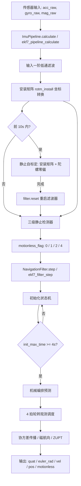
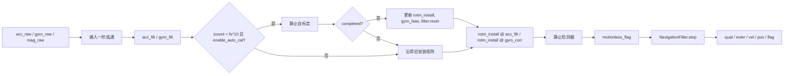
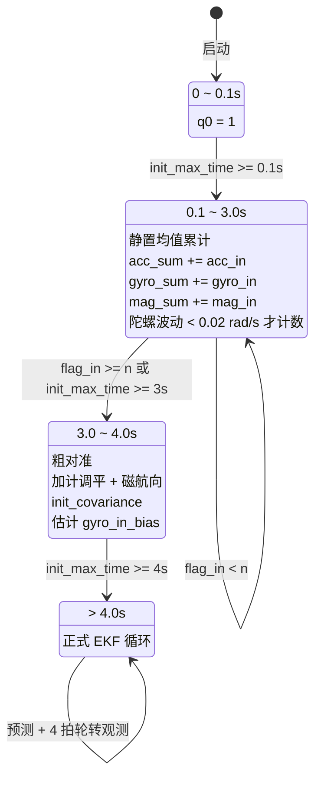
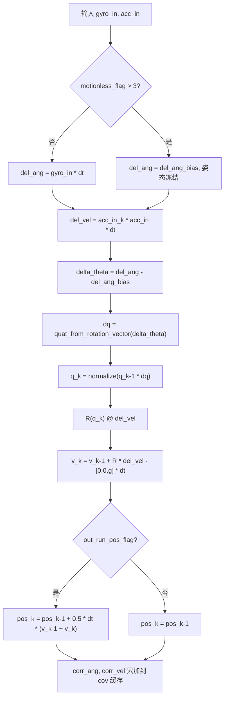
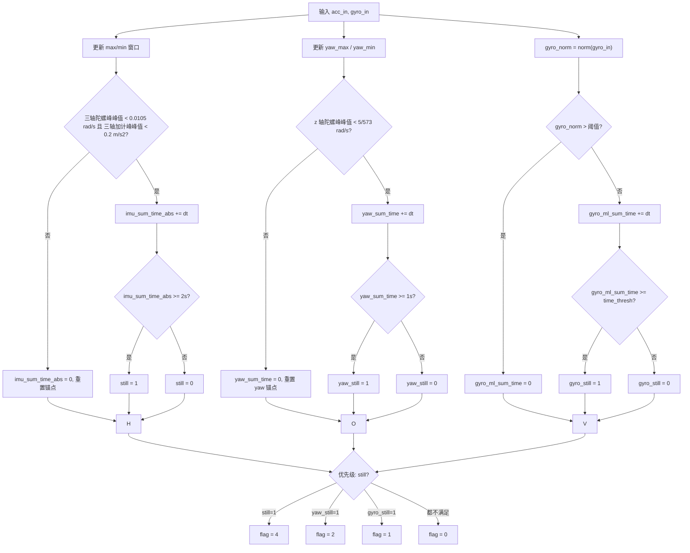
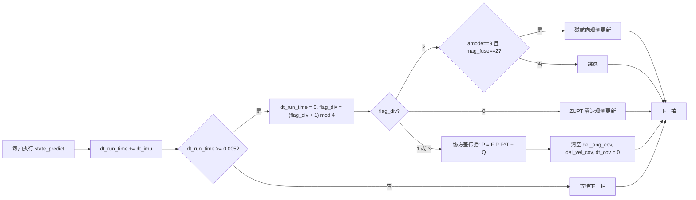

# ekf7 代码总结与流程详解

> 本文档面向希望理解 `quat-zupt-ekf` 项目内部实现与数据流的读者。内容覆盖 Python 包 `ekf7/` 与 C99 移植 `c/`，力求把"流程"与"为什么这样写"讲清楚。

---

## 1. 项目总览

`ekf7` 是一个**七状态全量 EKF 姿态解算器**，输入为 IMU（加速度计 + 陀螺仪 ± 磁力计），输出为：

- 姿态四元数 `q = [q0, q1, q2, q3]`（wxyz）
- ENU 导航系速度 `v = [vE, vN, vU]`
- 短时相对位置 `pos = [pE, pN, pU]`
- 欧拉角 `euler_rad = [roll, pitch, yaw]`
- 静止标志 `motionless`

核心特点：

- **全量式 EKF**：协方差直接在 7 维状态上传播，不是现代常见的误差状态 EKF（ES-EKF）。
- **ZUPT 零速修正**：检测到静止时把速度作为伪观测。
- **磁航向修正**（九轴模式）：提供偏航角的绝对参考。
- **静止检测 + 在线零偏估计**：静止窗口内估计陀螺零偏并指数平滑。
- **安装矩阵自标定**：上电前 10 秒内自动估计 IMU 安装倾斜与陀螺零偏。
- **双实现一致性**：Python 参考实现 + C99 移植，经差分验证一致。

---

## 2. 数据流总图



---

## 3. 状态向量与坐标系

### 3.1 状态向量

```
x = [q0, q1, q2, q3, vE, vN, vU]ᵀ   ∈ ℝ⁷
```

- 四元数表示体坐标系到 ENU 导航坐标系的旋转。
- 速度在 ENU 导航系中表达。

### 3.2 坐标约定

- **四元数**：Hamilton 约定，`q = [w, x, y, z]`，对应旋转 `w + xi + yj + zk`。
- **欧拉角**：`[roll, pitch, yaw]`（rad），其中 pitch 取负号，与 C# 原始实现一致。
- **加速度计**：输出的是比力（specific force），静止时约等于 `+g` 在体 z 轴。
- **ENU**：东-北-天，重力向量在导航系为 `[0, 0, -g]`。

---

## 4. 模块职责详解

### 4.1 Python 包结构

| 文件 | 行数 | 职责 |
|------|------|------|
| `math_utils.py` | 30 | `wrap_to_pi`、`cross3`、标量一阶低通 `kfilter_inplace` |
| `quaternion.py` | 89 | 四元数乘法、归一化、DCM、旋转向量/欧拉角互转 |
| `parameters.py` | 45 | 所有可调参数的默认值（200Hz 整定） |
| `jacobian.py` | 213 | 解析雅可比 `F7`、`Q7`、磁航向梯度 `H_dgc` |
| `alignment.py` | 66 | 粗对准：加计调平、磁航向、初始协方差 |
| `prediction.py` | 51 | 机械编排递推 + 协方差传播 |
| `observations.py` | 63 | ZUPT 与磁航向观测更新 |
| `motion.py` | 87 | 三级静止检测器 |
| `auto_calibration.py` | 91 | 静止自标定：安装矩阵 + 陀螺零偏 |
| `navigation_filter.py` | 273 | 主滤波器：初始化状态机 + 4 拍观测调度 |
| `pipeline.py` | 76 | 端到端封装 `ImuPipeline` |

### 4.2 C99 移植结构

| 文件 | 对应 Python |
|------|-------------|
| `c/ekf7.h` | 全部公共 API |
| `c/ekf7_math.c` | `quaternion.py` + `math_utils.py` |
| `c/ekf7_jacobian.c` | `jacobian.py` |
| `c/ekf7_filter.c` | `alignment.py` + `prediction.py` + `observations.py` + `navigation_filter.py` |
| `c/ekf7_motion.c` | `motion.py` + `auto_calibration.py` |
| `c/ekf7_pipeline.c` | `pipeline.py` |
| `c/test_runner.c` | 差分验证驱动 |

---

## 5. 核心算法流程

### 5.1 端到端管线（ImuPipeline）



每拍输入 raw IMU，执行：

1. **输入低通**
   ```
   acc_filt  ← (1-k)·acc_filt + k·acc_raw
   gyro_filt ← (1-k)·gyro_filt + k·gyro_raw
   ```
   目的是抑制高频噪声，避免静止检测器被毛刺触发。

2. **坐标转换**
   ```
   gyro_corr = gyro_filt - gyro_bias
   acc_in    = rotm_install @ acc_filt
   gyro_in   = rotm_install @ gyro_corr
   ```
   自标定完成后 `rotm_install` 不再变；`gyro_bias` 来自自标定。

3. **前 10s 静止自标定**
   - 在上电后前 `fs*10` 拍内运行。
   - 检测到持续静止 2s 后，进入三段式窗口：
     - 第 1 段：清空累加器
     - 第 2 段：累加 acc/gyro
     - 第 3 段：计算均值，得到 `gyro_bias` 与安装矩阵 `imu_r`
   - 完成后调用 `filter.reset()` 重启滤波器。

4. **静止检测**
   - 三级检测器见 5.4 节。

5. **EKF 步进**
   - 调用 `NavigationFilter.step()`。

### 5.2 初始化状态机（NavigationFilter.step）



滤波器启动后经历 4 个阶段：

| 阶段 | 时间 | 行为 |
|------|------|------|
| 0 | 0 ~ 0.1s | 强制 `q0 = 1`，姿态保持单位四元数 |
| 1 | 0.1 ~ 3.0s | 静置均值累计：累加 acc/gyro/mag，同时要求陀螺逐拍波动 < 0.02 rad/s 才计数 |
| 2 | 3.0 ~ 4.0s | 粗对准：加计调平 + 磁航向，初始化协方差，估计初始陀螺零偏 |
| 3 | > 4.0s | 正式 EKF 循环 |

粗对准细节：

1. **加计调平**：用平均比力方向把体 z 轴对齐到重力反方向。
   - `tilt = atan2(√(ax²+ay²), az)`
   - 旋转轴 `axis = acc × ẑ`
   - 构造一个最小旋转四元数。

2. **磁航向**：保留 roll/pitch，用磁向量在水平面的投影计算 yaw。
   - `yaw = declination + atan2(mE, mN)`

3. **初始协方差**：
   - 四元数部分：`quat_err²` 对角；六轴模式下 `q3`（yaw）误差置 0。
   - 速度部分：`[vel_err_ne², vel_err_ne², vel_err_d²]`。

### 5.3 预测步

状态预测公式：

```
δθ  = (gyro_in - gyro_bias) · dt                # 角增量，已扣零偏
qₖ  = normalize(qₖ₋₁ ⊗ quat_from_rotation_vector(δθ))

vₖ  = vₖ₋₁ + R(qₖ)·δv - [0, 0, g]·dt
posₖ = posₖ₋₁ + 0.5·dt·(vₖ₋₁ + vₖ)   （仅在 out_run_pos_flag 开启时）
```

其中 `δv = acc_in_k · acc_in · dt` 是速度增量，`acc_in_k` 是加计标度因子（粗对准时由重力范数反推）。

**协方差传播**：

```
Pₖ = F₇ · Pₖ₋₁ · F₇ᵀ + Q₇
```

- `F₇` 是 7×7 状态转移矩阵，由 `jacobian.calc_f7()` 显式标量展开。
- `Q₇` 是 7×7 过程噪声协方差，由 `jacobian.calc_q7()` 显式标量展开。
- 每完成传播后做对称化：`(P + Pᵀ)/2`。
- 对角线负值截断为 0。

预测步不是每拍都执行，而是累积 5ms（即 200Hz 下约每拍一次）后由 4 拍轮转调度触发。



### 5.4 静止检测器

输出 `motionless_flag`：

| 值 | 含义 | 判定条件 |
|----|------|----------|
| 0 | 运动 | 三项都不满足 |
| 1 | 低角速率 | 陀螺模长持续低于阈值 |
| 2 | 仅偏航静止 | z 轴陀螺峰峰值小于阈值 1s |
| 4 | 完全静止 | 三轴陀螺 + 三轴加计峰峰值都持续 2s 小于阈值 |

检测逻辑采用**窗口峰峰值 + 突破锚点重置**：



- 维护 `acc_raw_max_abs / min_abs` 和 `gyro_raw_max_abs / min_abs`。
- 若任一轴峰峰值超过阈值，则时间清零、窗口锚点重置为当前输入。
- 若连续 2s 未突破，则判定完全静止。

> ⚠️ **注意**：这种检测方式在**持续匀速旋转**时会把波动很小的陀螺误判为静止，导致 yaw 冻结、零偏被污染。往复运动场景无碍，匀速转弯场景慎用。

### 5.5 观测更新

#### 5.5.1 ZUPT 零速观测

观测模型：

```
z = [0, 0, 0]ᵀ
h(x) = v = [vE, vN, vU]ᵀ
H = [0₃ₓ₄ | I₃]
S = H P Hᵀ + R
ν = v - 0 = v
```

任一轴的创新 `ν_i` 超过卡方门限则整拍拒绝：

```
ν_i² / (gate² · S_ii) > 1  →  拒绝
```

量测方差 `R` 和门限 `gate` 按运动档位自适应：

| motionless | R | gate | 额外行为 |
|------------|---|------|----------|
| 0（运动） | 10000 | body_vel_gate × 0.0001 | — |
| 1（低角速率） | 1.0 | body_vel_gate | 若 \|v\|₁ > 0.5 则清零 |
| 2（仅偏航静止） | 0.01 | body_vel_gate × 10 | 若 \|v\|₁ > 0.5 则清零 |
| 4（完全静止） | 0.0001 | body_vel_gate × 100 | 若 \|v\|₁ > 0.1 则清零 |

#### 5.5.2 磁航向观测

观测模型：

```
m_nav = R(q) · m_body
heading = atan2(m_nav_E, m_nav_N)
ν = heading - declination
```

`H = ∂heading/∂q` 由 `calc_h_hdgc()` 解析计算。

- 运动状态下：前 2s `R=100`，之后 `R = 10·mag_hdg_error²`。
- 静止超过 10s：用磁航向重新粗对准、重置协方差，`R` 调小以快速收敛。
- 创新门限由 `mag_hdg_gate` 控制。

### 5.6 陀螺零偏在线估计

在 `motionless_flag == 4` 期间，分三段窗口：

1. 第 1 段：清空累加器
2. 第 2 段：累加 gyro_in
3. 第 3 段：再累积一段，然后计算第 2 段均值 `mean1`

估计策略：

- 若当前零偏几乎为零（\|bias\|₁ < 1e-5），直接赋值 `mean1`。
- 否则做指数平滑：`bias ← (1-k_bias)·bias + k_bias·mean1`。
- 更新 `del_ang_bias = bias · dt`。

当完全静止时，预测步用 `del_ang_bias` 替代真实 `del_ang`，实现姿态冻结，避免零偏继续积分。

---

## 6. 4 拍轮转观测调度



主循环以 `dt_run_time >= 0.005` 为节拍触发（200Hz 时约每拍一次），`flag_div` 在 `{0,1,2,3}` 间轮转：

| flag_div | 操作 |
|----------|------|
| 1 或 3 | **协方差传播**：用累积的 `del_ang_cov` / `del_vel_cov` / `dt_cov` 更新 P |
| 2 | **磁航向观测更新**（九轴且启用磁融合） |
| 0 | **ZUPT 零速观测更新** |

这样设计的好处：

- 避免每拍都传播 7×7 协方差，降低计算量。
- 把昂贵运算均匀分散到相邻节拍。

---

## 7. 关键参数表

参数集中在 `Parameters` / `ekf7_params`：

| 参数 | 默认值 | 含义 |
|------|--------|------|
| `fs` | 200.0 | 采样率 Hz |
| `work_mode` | 0/1/2 | 位置积分手感档位 |
| `amode` | 6 或 9 | 6=六轴（无磁），9=九轴（磁航向融合） |
| `gyro_filt_k` / `acc_filt_k` | 0.1 | 输入低通系数 |
| `g0` | 9.7955 | 当地重力加速度 |
| `ang_rate_noise` | 0.01 rad | 陀螺角度增量过程噪声 |
| `accel_noise` | 0.35 m/s | 加计速度增量过程噪声 |
| `body_vel_gate` | 10.0 | ZUPT 创新门限基数 |
| `mag_hdg_error` | 0.1745 rad² | 磁航向测量噪声（约 10°） |
| `mag_hdg_gate` | 5.0 | 磁航向卡方门限 |
| `mag_decl_deg` | 0.0 | 磁偏角（度） |
| `ang_rate_bias_k` | 0.04 | 陀螺零偏指数平滑系数 |
| `quat_err` | 0.1 | 初始四元数协方差标准差 |
| `vel_err_ne` / `vel_err_d` | 5.0 / 1.0 | 初始速度协方差标准差 |
| `auto_cal_gyro_max_min` | π/900 | 自标定静止陀螺峰峰值阈值 |
| `auto_cal_acc_max_min` | 0.05 | 自标定静止加计峰峰值阈值 |

---

## 8. Python 与 C99 实现的差异

两者算法逻辑逐行对应，差异仅在于工程表达：

| 方面 | Python | C99 |
|------|--------|-----|
| 矩阵运算 | NumPy | 手写循环 |
| 3×3 求逆 | `np.linalg.inv` | 伴随式 `inv3` |
| 精度 | `float64`（NumPy 默认） | `double`（可改为 `float`） |
| 数据结构 | 类与对象 | 结构体 |
| 动态分配 | 有 | 无 |
| 依赖 | 仅 NumPy | 零依赖 |

差分验证结果：

| 场景 | 拍数 | 最大绝对差 | 静止判别 |
|------|------|------------|----------|
| amode=9 | 1000 | 5.1e-15 ~ 3.8e-10 | 完全一致 |
| amode=9 | 3000 | 1.1e-8 | 完全一致 |
| amode=6 | 3000 | 3.2e-8 | 完全一致 |

差异来源：求逆方式与求和顺序导致的浮点噪声，远低于物理显著性阈值。

---

## 9. 使用入口

### Python

```python
from ekf7 import ImuPipeline

pipe = ImuPipeline(fs=200.0, work_mode=1, amode=9)
for acc, gyro, mag in samples:
    out = pipe.calculate(acc, gyro, mag)
    out["quat"]        # [w, x, y, z]
    out["euler_rad"]   # [roll, pitch, yaw]
    out["vel"]         # ENU 速度
    out["pos"]         # 短时相对位置
    out["motionless"]  # 0 / 1 / 2 / 4
```

### C99

```c
#include "ekf7.h"

ekf7_pipeline pipe;
 ekf7_pipeline_init(&pipe, 200.0, 1, 9);

ekf7_output out;
for (...) {
    ekf7_pipeline_calculate(&pipe, acc, gyro, mag, &out);
    // out.quat / out.euler_rad / out.vel / out.pos / out.motionless
}
```

---

## 10. 已知局限

1. **持续匀速旋转会被误判为静止**：峰峰值 + 锚点重置式检测器的固有缺陷，导致 yaw 冻结、零偏污染。
2. **全量四元数协方差传播**：大机动下数值稳定性弱于现代 ES-EKF。
3. **位置输出只是短时相对演示量**：不是 PDR 级精度。
4. **默认重力常量** `g0 = 9.7955 m/s²` 需按当地纬度修改。

---

## 11. 参考阅读顺序

如果想从代码层面跟着数据流读一遍，建议按以下顺序：

1. `ekf7/parameters.py` / `c/ekf7.h`：先看可调参数。
2. `ekf7/math_utils.py` + `ekf7/quaternion.py` / `c/ekf7_math.c`：基础工具。
3. `ekf7/jacobian.py` / `c/ekf7_jacobian.c`：EKF 的 F/Q/H。
4. `ekf7/motion.py` + `ekf7/auto_calibration.py` / `c/ekf7_motion.c`：静止检测与自标定。
5. `ekf7/alignment.py` + `ekf7/prediction.py` + `ekf7/observations.py` / `c/ekf7_filter.c`：对准、预测、观测。
6. `ekf7/navigation_filter.py` / `c/ekf7_filter.c`：主循环与调度。
7. `ekf7/pipeline.py` / `c/ekf7_pipeline.c`：端到端封装。
8. `examples/demo_synthetic.py`：行为验证示例。
